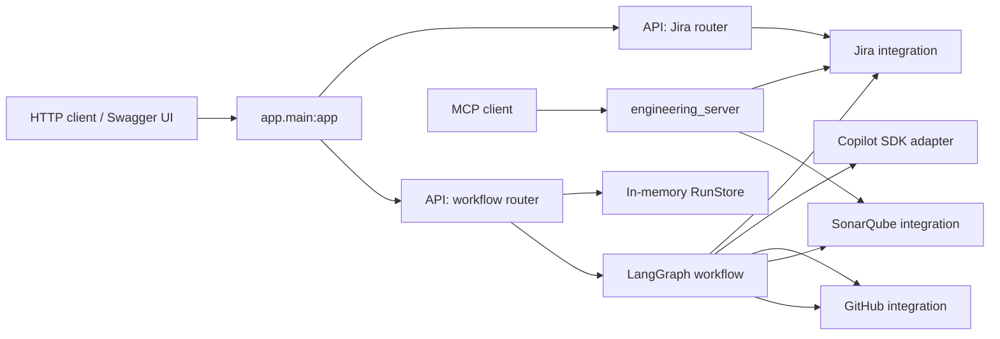

# AI-DLC Reference Implementation: Refactor and Architecture Guide

## Purpose

This guide describes the reorganized project layout, the role of each canonical module, what moved or changed, how an HTTP request flows through the system, and how to run and verify it. The refactor is intended to improve discoverability and separation of concerns without changing the externally visible API paths, workflow sequence, Jira/GitHub/Sonar integrations, configuration variable names, or Copilot prompts.

> **Compatibility note:** Old Python import paths and the old MCP module name are retained as thin compatibility shims. New code should import from the canonical paths shown below.

## At a glance

```text
ai-dlc-reference/
├── app/
│   ├── main.py                         # FastAPI composition root; keep app.main:app
│   ├── api/routes/
│   │   ├── jira.py                     # Jira read endpoint
│   │   └── workflows.py                # Workflow create/read/approval endpoints
│   ├── agents/copilot_service.py       # Copilot SDK adapter
│   ├── core/config.py                 # Settings and environment loading
│   ├── integrations/
│   │   ├── github_client.py            # GitHub API/repository operations
│   │   ├── jira_client.py              # Jira REST operations and errors
│   │   └── sonarqube_client.py         # SonarQube quality-gate API
│   ├── schemas/models.py               # HTTP request/approval models
│   ├── workflow/
│   │   ├── graph.py                    # LangGraph nodes and edges
│   │   └── state.py                    # Shared graph state type
│   ├── clients/                        # Legacy import shims
│   ├── config.py                       # Legacy import shim
│   ├── copilot_service.py              # Legacy import shim
│   ├── graph.py                        # Legacy import shim
│   ├── models.py                       # Legacy import shim
│   ├── registry.py                     # Agent-definition file scanner
│   └── store.py                        # In-memory API run store
├── mcp_servers/
│   ├── engineering_server.py           # Canonical MCP tools/server
│   └── engineering.py                 # Legacy import/launch shim
├── tests/
├── docs/
├── Makefile
├── requirements.txt
└── README.md
```

## Architecture and responsibilities

The app is composed in `app/main.py`. It loads configuration, constructs the integration and Copilot clients, builds the LangGraph, registers the health endpoint and exception handler, and mounts the Jira/workflow routers. This keeps the familiar server command `uvicorn app.main:app --reload` working.

The layers have distinct responsibilities:

- **API (`app/api/routes`)** — translates HTTP requests into calls to application services and returns the same response shapes as before. It should not contain external-service protocol details.
- **Schemas (`app/schemas`)** — validates the HTTP body for workflow creation and approval.
- **Workflow (`app/workflow`)** — defines LangGraph state, steps, interrupts, and routing. It calls services but does not construct HTTP responses.
- **Agents (`app/agents`)** — wraps the Copilot SDK and provides the mock/real agent execution boundary.
- **Integrations (`app/integrations`)** — contains Jira, GitHub, and SonarQube communication.
- **Core (`app/core`)** — owns settings and environment-variable loading.
- **Store (`app/store.py`)** — holds workflow results in memory for the REST endpoints.
- **MCP (`mcp_servers`)** — exposes Jira and SonarQube tools to MCP-capable clients independently of the REST API.



## Step-by-step workflow execution

### 1. Application startup

1. Uvicorn imports `app.main` and its `app` FastAPI object.
2. `app.core.config.settings` reads the existing `.env` file and process environment. The same setting names and defaults are retained.
3. `app.main` constructs `JiraClient`, `GitHubClient`, `SonarClient`, and `CopilotService`, passing each the existing configuration and `mock_mode` flag.
4. `build_graph((jira, github, sonar, copilot, settings))` compiles the LangGraph with an in-memory checkpointer.
5. The app registers `GET /health`, the Jira error handler, and the routers created by `create_jira_router()` and `create_workflow_router()`.

### 2. Read a Jira issue directly

`GET /api/jira/issues/{issue_key}` enters the Jira router, which calls `jira.get_story(issue_key)`. In real mode the Jira client requests the configured Jira REST API and returns the issue key, summary, description, and acceptance-criteria field. Connection, permission, HTTP, and unexpected-response errors are converted to `JiraError` and the FastAPI exception handler returns its configured HTTP status and detail. In mock mode the client returns its demo story.

### 3. Create a workflow

`POST /api/workflows` accepts a `WorkflowRequest` containing `jira_key`, `repository`, and optional `story`.

1. The router generates a UUID `run_id`.
2. In real mode it awaits `github.clone_if_needed(repository, workspace_root)`; in mock mode it uses the configured workspace root without cloning.
3. The router creates the initial graph state (`run_id`, Jira key, repository, story, workspace, counters, output/error lists) and a LangGraph `thread_id` configuration.
4. It invokes `graph.ainvoke(initial, config)`, then saves the returned graph state and config in `RunStore` under that run ID.
5. The response returns the run ID, state, and the existing message indicating that approval may be required.

### 4. Graph loads the story and prepares architecture

The current graph proceeds through these nodes:

1. **`load_story`** — calls Jira and puts the complete story data in `requirements`; the summary is copied to `story`.
2. **`architecture`** — returns the current fixed Spring Boot REST architecture template. This step is code-defined; it does not call Copilot or an LLM.
3. **`human_approval`** — raises a LangGraph interrupt containing the architecture so a human can review it. The graph is checkpointed in memory and the initial request returns paused.

The approval endpoint resumes that paused graph. The current graph node returns `rejected` if `approved` is false, or `approved` otherwise. **The graph edge after this node is unconditional**, so a rejection currently sets the state to rejected but does not itself terminate the graph. This is existing workflow behavior, not introduced by moving the code; users should be aware of it before using the workflow for consequential changes.

### 5. Plan and coding-agent work

After the approval node, `plan` produces the same fixed task list: implement the endpoint and generate tests. `develop` builds the existing detailed prompt from the Jira requirements, architecture, and tasks, then calls `CopilotService.run_agent("springboot-developer", ...)`.

- In mock mode, `CopilotService` returns synthetic output and does not start the Copilot SDK.
- In real mode, it creates a Copilot client/session with the selected model and repository working directory, sends the prompt, and returns the response summary.

### 6. Test-agent step

The graph then calls the test-generator agent with the instruction to run relevant tests and fix story-related test/build problems. The graph records a `test_result` with status `PASSED` and the agent response. That status assignment is how this reference workflow currently records the result; it is not an independent CI test-run parser.

### 7. Branch, PR, and quality gates

1. **`create_pr`** derives a branch name from the Jira key and run ID, asks the GitHub integration to create the branch from the configured base, then requests a pull request and records its number and URL.
2. **`quality`** checks the SonarQube quality gate for the configured project key derived from the repository name.
3. The same node dispatches the configured GitHub Actions workflow (the CodeQL workflow by default) and reads the latest run for the branch.
4. The graph marks quality passed only when Sonar reports passed and CodeQL has a success or neutral conclusion.

These operations are real external effects when `MOCK_MODE=false`; access depends on credentials, repository permissions, branch/workflow configuration, and Sonar project availability.

### 8. Remediation and final approval

- If quality fails and the configured remediation limit has not been reached, `quality_route` selects `remediate`. Copilot receives the Sonar/CodeQL results and is asked to fix genuine story-related findings. The graph loops back through the test step and then the PR/quality steps.
- When the gate passes, the graph reaches `final_approval`, which interrupts again with the PR URL and quality result for human review.
- A positive final approval sets `approved_for_merge`; a negative one sets `rejected`.
- **The app does not merge the pull request or deploy.** Final approval records a decision only.

The compiled checkpointer is `InMemorySaver`, and `RunStore` is also in-memory. Process restart loses these run records/checkpoints; persistent storage is a production-hardening task.

## REST endpoints (same public paths)

| Method | Path | Responsibility |
|---|---|---|
| `GET` | `/health` | Return app status and whether mock mode is enabled. |
| `GET` | `/api/jira/issues/{issue_key}` | Fetch a Jira story. |
| `POST` | `/api/workflows` | Start a workflow; it can pause at human approval. |
| `GET` | `/api/workflows/{run_id}` | Read the state held by the in-memory store. |
| `POST` | `/api/workflows/{run_id}/approval` | Resume a workflow with the approval body. |

The refactor moves Jira and workflow handlers into router factories; `app.main` includes them. Route paths, methods, request models, core handler operations, and response fields remain the same. The workflow endpoints now also declare their existing 404 response in OpenAPI metadata; this documents behavior and does not change it.

## MCP server

The canonical server is `mcp_servers/engineering_server.py` and exposes:

- **`jira_get_story(issue_key)`** — fetches a story through the shared Jira client implementation.
- **`sonar_quality_gate(project_key)`** — fetches and reports a SonarQube quality-gate status.

The Makefile `mcp` target now launches `python -m mcp_servers.engineering_server`. The old `mcp_servers.engineering` module remains available as a compatibility alias/launcher. MCP is a separate server process; starting FastAPI does not automatically start MCP.

## File-by-file change register

### New canonical implementation files

| New path | Responsibility / source of moved code |
|---|---|
| `app/core/config.py` | Settings class and singleton, moved from the former top-level configuration module. |
| `app/schemas/models.py` | `WorkflowRequest` and `Approval`, moved from the former models module. |
| `app/integrations/jira_client.py` | Jira HTTP client and `JiraError`, moved from `app/clients/jira.py`. |
| `app/integrations/github_client.py` | GitHub branch, PR, Actions, and clone operations, moved from `app/clients/github.py`. |
| `app/integrations/sonarqube_client.py` | SonarQube quality-gate client, moved from `app/clients/sonar.py`. |
| `app/agents/copilot_service.py` | Copilot SDK adapter, moved from `app/copilot_service.py`. |
| `app/workflow/state.py` | `AIDLCState`, separated from the graph implementation. |
| `app/workflow/graph.py` | `build_graph()` and its nodes/edges, moved from `app/graph.py`; imports the state type from `state.py`. |
| `app/api/routes/jira.py` | Router factory for Jira lookup. |
| `app/api/routes/workflows.py` | Router factory for workflow creation, retrieval, and approval. |
| `mcp_servers/engineering_server.py` | Canonical MCP implementation, moved from `mcp_servers/engineering.py`. |

The new Python package directories also contain `__init__.py` files so they can be imported as packages: `app/core`, `app/schemas`, `app/integrations`, `app/agents`, `app/workflow`, `app/api`, and `app/api/routes`.

### Existing files updated

| Existing path | Change |
|---|---|
| `app/main.py` | Imports canonical modules, constructs services/graph as before, keeps `/health` and the Jira error handler, and mounts the new routers. Startup remains `app.main:app`. |
| `app/config.py` | Replaced the old implementation with a re-export shim to `app.core.config`. |
| `app/models.py` | Re-exports schema classes from `app.schemas.models`. |
| `app/copilot_service.py` | Re-exports `CopilotService` from `app.agents.copilot_service`. |
| `app/graph.py` | Re-exports `build_graph` and `AIDLCState` from the workflow package. |
| `app/clients/github.py` | Re-exports `GitHubClient` from the integrations package. |
| `app/clients/jira.py` | Re-exports `JiraClient` and `JiraError`; also exposes `httpx` to preserve the existing test monkeypatch path. |
| `app/clients/sonar.py` | Re-exports `SonarClient`. |
| `mcp_servers/engineering.py` | Keeps the old launch path and aliases old imports to the canonical module to preserve function monkeypatch/import compatibility. |
| `Makefile` | Changes only the MCP target to the new canonical server module. `install`, `run`, and `test` targets are unchanged. |
| `README.md` | Adds a structure overview and explains the old paths remain compatibility shims. |

### Existing files intentionally unchanged

- `app/store.py` and `app/registry.py` remain in place.
- `.env`, `.env.example`, and all setting names remain unchanged.
- The Pydantic fields, Jira/GitHub/Sonar client operations, Copilot prompt text, and external endpoint paths were not intentionally changed by the reorganization.
- Existing tests remain at their original paths; their legacy imports continue to work through the shims.

## Runtime-preservation notes

A pure file move is not the only edit; these small adjustments were needed to make the new organization work cleanly:

1. **Route extraction:** Handler bodies were moved into router factories. `app.main` supplies the already-created service objects to those factories. URL paths and HTTP methods are preserved.
2. **Sync LangGraph nodes:** `architecture`, `human_approval`, `plan`, and `final_approval` do not perform `await` operations. They are ordinary `def` functions now; their state values, interrupts, and graph connections remain the same. LangGraph accepts synchronous and asynchronous nodes in the same graph.
3. **Git clone off the event loop:** `clone_if_needed` still awaits the same checked `git clone` operation and returns the same target path, but runs `subprocess.run` via `asyncio.to_thread` so the synchronous subprocess does not block the event loop.
4. **OpenAPI response descriptions:** The two existing workflow 404s are now described in route metadata; the runtime 404 status and detail are unchanged.
5. **Compatibility shims:** Rather than delete old module names, they re-export the canonical symbols. This reduces breakage for scripts/tests that import the previous locations.

## How to run and test

Run these commands from the project root (the directory containing `app/`, `Makefile`, and `requirements.txt`):

```powershell
# Start the API using the project's virtual environment
.\.venv\Scripts\python.exe -m uvicorn app.main:app --reload --port 8001
```

Then visit `http://127.0.0.1:8001/docs`. To run tests in another terminal:

```powershell
.\.venv\Scripts\python.exe -m pytest -q
```

The MCP server can be started separately:

```powershell
.\.venv\Scripts\python.exe -m mcp_servers.engineering_server
```

The full test suite was run after the refactor: **16 tests passed**. Import compatibility for the canonical MCP module and legacy MCP module was also checked. The tests verify the unchanged health/Jira API behavior and existing Jira-client behavior; this is validation evidence, not a mathematical guarantee that every future integration scenario is unchanged.

## Suggested presentation narrative

1. Start with the motivation: the original app had core responsibilities at the root of `app/`, making routes, integrations, workflow, and agent code harder to locate.
2. Explain the new layers: API → workflow/agent orchestration → integration clients → external systems.
3. Show `app/main.py` as the composition root that wires these pieces together.
4. Walk one Jira workflow request from API validation to human architecture approval, Copilot execution, quality checks, and final approval.
5. Highlight compatibility: same startup target, endpoint paths, config variable names, and legacy import shims.
6. Close with validation and known limits: 16 tests pass; run/checkpoint storage is still in-memory, there is no automatic merge/deploy, and the current architecture/plan are fixed templates.
